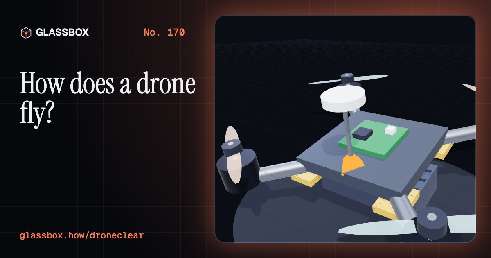
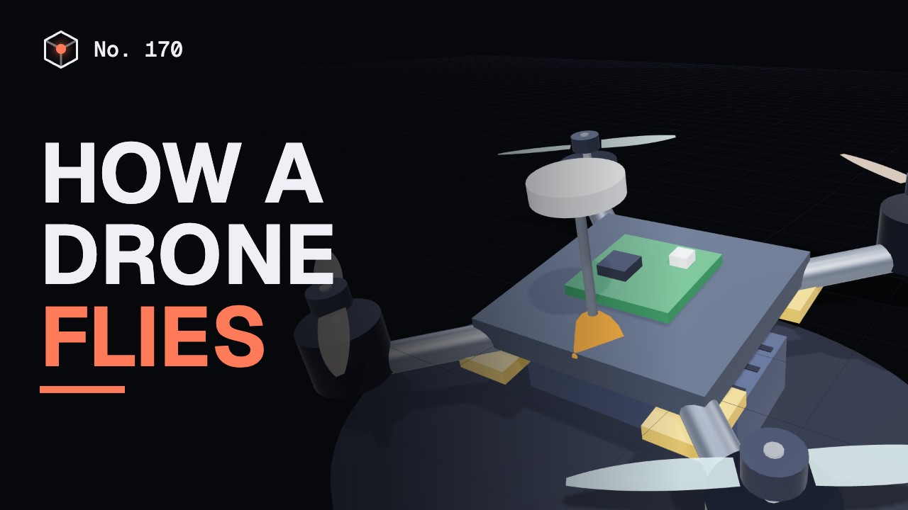
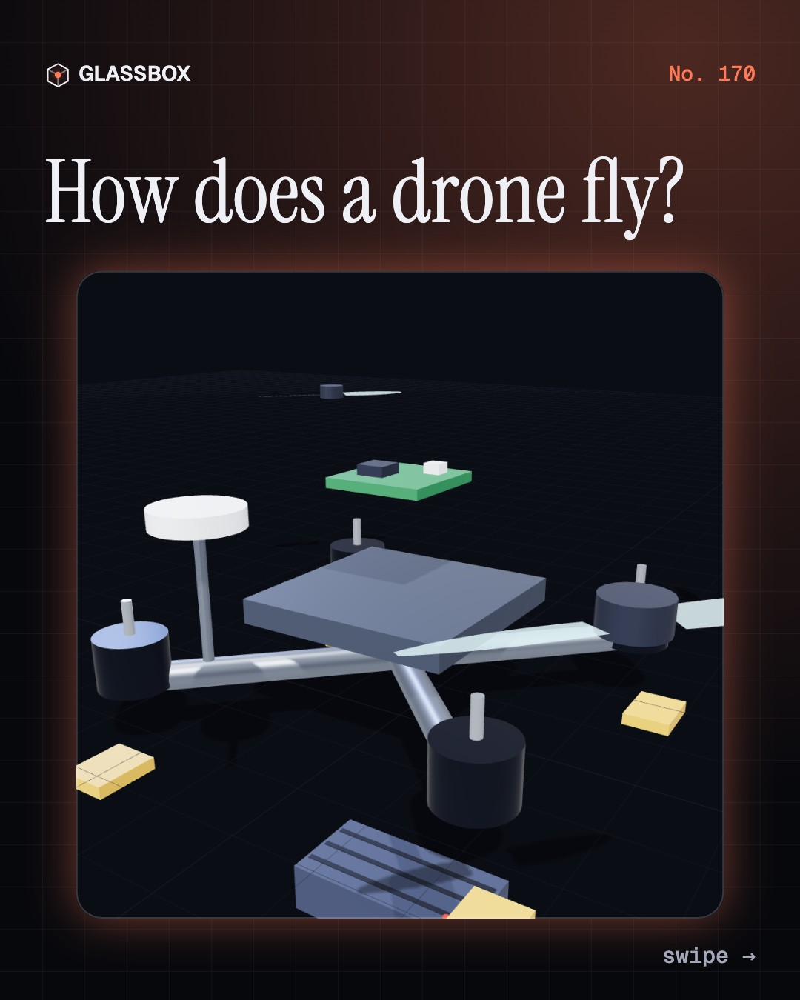
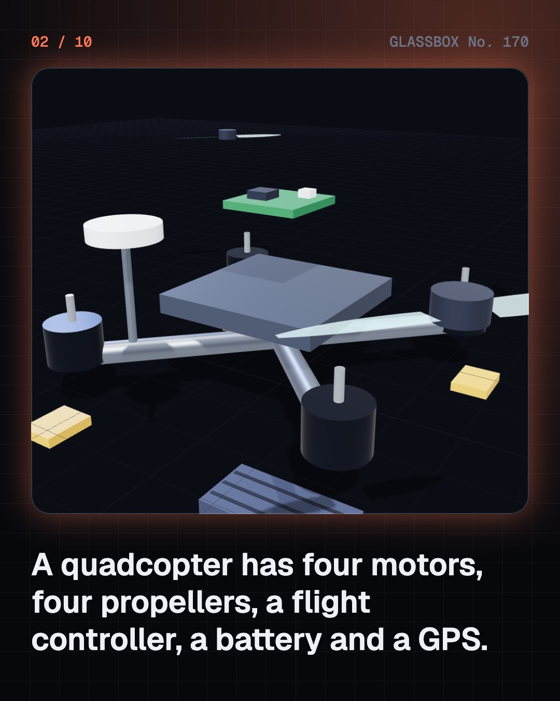
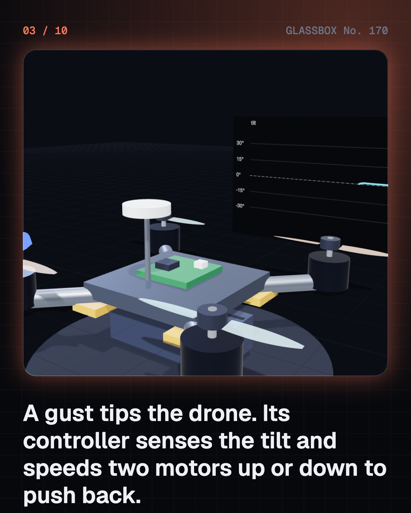
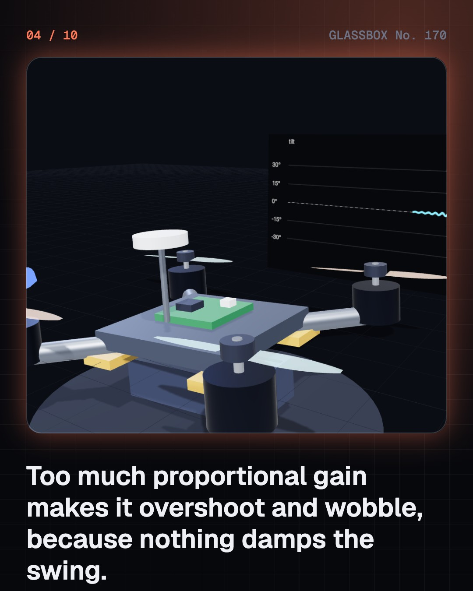

<!-- glassbox:start -->
<!-- Generated from glassbox.json by the Glassbox hub (npm run readme -- droneclear). Edit glassbox.json, not this block. -->
<p align="center"><a href="https://glassbox.how/e/droneclear/"></a></p>

<h1 align="center">DroneClear</h1>

<p align="center"><b>How does a drone fly?</b><br>A drone has no tilting blades and no gearbox, yet it hovers, climbs and turns on the spot. It does it by changing four propellers' speeds up to hundreds of times a second.</p>

<p align="center"><a href="https://glassbox.how/droneclear/"><b>▶ Play with it</b></a> &nbsp;·&nbsp; <a href="https://glassbox.how/e/droneclear/">Read the 60-second explainer</a> &nbsp;·&nbsp; <a href="https://glassbox.how/droneclear/glassbox/reel.mp4">Watch the 40-second video</a></p>

<p align="center">
  <a href="https://glassbox.how/e/droneclear/"></a>
  <a href="https://glassbox.how/e/droneclear/"></a>
  <a href="LICENSE"></a>
  <a href="LICENSE-CONTENT.md"></a>
  <a href="#privacy"></a>
</p>

## In 60 seconds

1. **The one-line idea.** A quadcopter moves by changing how fast four propellers spin. Speed up one side and it tips; speed up two diagonal propellers and it turns.
2. **The part people get wrong.** A drone does not stay level by magic. A feedback loop measures the tilt hundreds of times a second, and a PID controller decides how hard to push back.
3. **Keeping level.** The P, I and D dials set how hard, how long and how smoothly the drone corrects. Too much P makes it wobble; too little lets it sag.
4. **Moving.** Lean to fly forward, speed all four to climb, and speed one diagonal pair to turn. The rotors never tilt.
5. **The battery.** Watt-hours against hover power set the flight time, and every extra gram of payload costs minutes.
6. **The rules and the uses.** India's Drone Rules, 2021 set green, yellow and red airspace and register drones on Digital Sky. Drones map, spray and deliver under official schemes.

## Words worth knowing

| Term | Meaning |
|---|---|
| **Quadcopter** | A drone with four motors and propellers, two spinning clockwise and two anticlockwise. |
| **Speed controller** | An electronic switch that sets how fast one motor turns by chopping the battery's power. |
| **Gyroscope** | A sensor that measures how fast the drone is turning around each axis. |
| **PID controller** | A feedback rule that combines a proportional push, an integral correction and a derivative brake. |
| **Net thrust** | Total rotor push minus the drone's weight; only this part changes its height. |
| **Watt-hour** | A unit of energy: one watt for one hour, equal to volts times amp-hours. |
| **All-up weight** | The drone plus its battery and payload, which decides its class under the Drone Rules. |
| **Digital Sky** | The DGCA's online platform for drone registration and the official airspace map. |

## A short history

**From a radio-controlled boat in 1898 to the quadcopters that map Indian villages and carry vaccines.**

- **1898** · A vessel steered from a distance (Nikola Tesla, New York, USA)
- **1940** · The first army order for radio targets (US Army and Radioplane, USA)
- **1999** · The first quadcopter with a camera (Makers of toy and research quadcopters, Japan and elsewhere)
- **2005** · Cheap sensors make the quadcopter practical (Electronics makers and hobbyists, Worldwide)
- **2021** · India notifies the Drone Rules, 2021 (Ministry of Civil Aviation, New Delhi, India)
- **2021** · India publishes its drone airspace map (Government of India, Digital Sky, online)
- **2022** · The Kisan Drone scheme for farmers (Ministry of Agriculture and Farmers Welfare, India)
- **2024** · Namo Drone Didi (Ministries of agriculture, rural development and fertilisers, India)

The full story, with 15 moments, charts, people and 13 sources: [glassbox.how/e/droneclear/history](https://glassbox.how/e/droneclear/history/). The data lives in [`history.json`](history.json).

## Video and slides

Made with the Glassbox studio from this box's storyboard (`window.glassbox.director`). Free to reuse under CC BY 4.0.

<a href="https://glassbox.how/droneclear/glassbox/video.mp4"></a>

<p><a href="glassbox/slide-1.jpg"></a> <a href="glassbox/slide-2.jpg"></a> <a href="glassbox/slide-3.jpg"></a> <a href="glassbox/slide-4.jpg"></a></p>

| File | What | Size |
|---|---|---|
| [`glassbox/reel.mp4`](https://glassbox.how/droneclear/glassbox/reel.mp4) | Reel / Short, with captions and soundtrack | 1080×1920 |
| [`glassbox/video.mp4`](https://glassbox.how/droneclear/glassbox/video.mp4) | YouTube video, with captions and soundtrack | 1920×1080 |
| `glassbox/slide-1…10.jpg` | Instagram carousel | 1080×1350 |
| `glassbox/thumb.jpg` | YouTube thumbnail | 1280×720 |
| `glassbox/cover.jpg` | Share card and repo social preview | 1200×630 |
| [`glassbox/history-reel.mp4`](https://glassbox.how/droneclear/glassbox/history-reel.mp4) | “History in 10 moments” Reel / Short | 1080×1920 |
| `glassbox/history-slide-*.jpg` | History carousel | 1080×1350 |
| `glassbox/post.json` | Post copy and schedule used by the publish kit | |

## Privacy

This box has no accounts and no ads, and it ships its own fonts and libraries. When you run it yourself it sends nothing anywhere. On glassbox.how, the site's `/bar.js` also loads Glassbox's analytics: **Google Analytics** to count visits (it asks first in the EU, UK and Switzerland, and stays off when your browser sends Global Privacy Control or Do Not Track) and **ClickTrust** to detect bots.

It remembers a few things **in your own browser only**, and never sends them anywhere:

| Browser storage key | What it holds |
|---|---|
| `droneclear.v1` | Which chapters you have opened, your best quiz scores, and sound on or off. |

Exactly what each one sees is at [glassbox.how/privacy](https://glassbox.how/privacy/).

## Licences

- **Code:** [MIT](LICENSE). Use it, change it, ship it.
- **Explanations, text, images and videos** (`glassbox.json`, `glassbox/`): [CC BY 4.0](LICENSE-CONTENT.md). Credit “Glassbox, glassbox.how/e/droneclear”.
- **Third-party parts** keep their own licences: [three.js](https://threejs.org) (MIT), [Geist, Instrument Serif](https://openfontlicense.org) (SIL OFL 1.1).
- The Glassbox name and logo aren't covered by either licence. See the [terms](https://glassbox.how/terms/).

Found a mistake? [Open an issue](https://github.com/bdeeps/droneclear/issues). Corrections happen in public.
<!-- glassbox:end -->

## Run it

It's plain HTML, CSS and JavaScript. No build step and no dependencies. Run locally, it contacts no other website.

```bash
python3 -m http.server 8000
```

Three.js and the fonts ship in `vendor/` and `fonts/`, so it also works offline.

Then open http://localhost:8000.

## How it's built

| File | What |
|---|---|
| `index.html`, `css/app.css` | The page and its styles |
| `js/app.js`, `js/stage.js`, `js/ui.js`, `js/kit.js` | The shared Glassbox 3D engine: chapters, 3D stage, controls, quiz, video director |
| `js/chapters/*.js` | One file per chapter: the 3D model, controls, text, key terms, quiz and video scenes |
| `glassbox.json` | Title, question, explainer beats, key terms, browser storage and credits shown on glassbox.how |
| `reel` in each chapter | The storyboard the Glassbox studio records into short videos |
| `glassbox/` | The published video, slides, thumbnail and post copy |
| `fonts/`, `vendor/three/` | Self-hosted Geist and Instrument Serif (SIL OFL 1.1) and three.js (MIT) |
